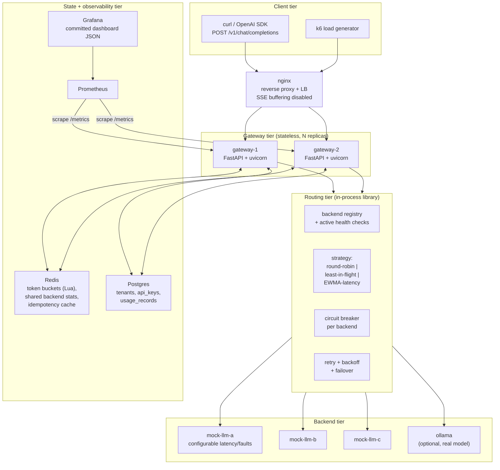

# StreamGate

**A load-aware, multi-tenant LLM serving gateway**: an OpenAI-compatible edge that
authenticates tenants, enforces distributed rate limits, streams tokens over SSE, and routes
each request to the healthiest inference backend with circuit breaking, retries and failover.

> Status: **Phase 0 (design)**. This README documents the target system. Sections marked
> _(not built yet)_ are filled in as phases land. No benchmark numbers are published until
> they are measured on real hardware — see [docs/BENCHMARKS.md](docs/BENCHMARKS.md).

---

## Why this project exists

Running an LLM is not the hard part any more — `ollama run` does that. The hard part is what
sits in front of it when you have many tenants, limited GPU capacity, and backends that are
slow, saturated, or occasionally dead. StreamGate is that layer: the piece of infrastructure
between an application and a fleet of inference servers.

It deliberately contains **no RAG and no agents**. It is a networking, concurrency and
distributed-state project that happens to speak the OpenAI API.

## Architecture



Full detail, including the request lifecycle sequence diagram and failure modes:
[docs/ARCHITECTURE.md](docs/ARCHITECTURE.md).

## Features

| Area | What it does |
| --- | --- |
| OpenAI compatibility | `POST /v1/chat/completions` with `stream: true` and `false`, `GET /v1/models` |
| Auth | `Authorization: Bearer sg_...` API keys, Argon2-hashed, mapped to tenants |
| Rate limiting | Per-tenant requests/min **and** tokens/min token buckets, atomic across replicas via a Redis Lua script, `429` + `Retry-After` |
| Streaming | SSE proxy that forwards upstream chunks with backpressure and cancels the upstream request when the client disconnects |
| Routing | Pluggable strategies: round-robin, least-in-flight, EWMA-latency + queue depth |
| Resilience | Per-backend circuit breaker (closed/open/half-open), retries with exponential backoff + full jitter, failover **before first token only** |
| Accounting | Per-request prompt/completion tokens, TTFT, total latency, cost, persisted to Postgres |
| Observability | Prometheus metrics (TTFT and latency histograms, in-flight gauges, breaker state, rate-limit hits), Grafana dashboard in-repo |
| Operations | Graceful shutdown that drains in-flight streams, request IDs, structured JSON logs, idempotency keys for non-streaming requests |

## Quickstart _(not built yet — Phase 1)_

```bash
cp .env.example .env
docker compose up --build
```

Then:

```bash
# health
curl -s localhost:8080/healthz

# create a tenant + key (admin API, requires ADMIN_TOKEN from .env)
curl -s -X POST localhost:8080/admin/tenants \
  -H "Authorization: Bearer $ADMIN_TOKEN" \
  -H 'Content-Type: application/json' \
  -d '{"name":"acme","rpm_limit":60,"tpm_limit":20000}'

# non-streaming completion
curl -s localhost:8080/v1/chat/completions \
  -H "Authorization: Bearer $SG_KEY" \
  -H 'Content-Type: application/json' \
  -d '{"model":"mock-small","messages":[{"role":"user","content":"hello"}]}'

# streaming completion
curl -N localhost:8080/v1/chat/completions \
  -H "Authorization: Bearer $SG_KEY" \
  -H 'Content-Type: application/json' \
  -d '{"model":"mock-small","stream":true,"messages":[{"role":"user","content":"hello"}]}'
```

Every endpoint with request/response examples: [docs/API.md](docs/API.md).

## Benchmarks

Not yet measured. The methodology, the scenarios, and an empty results table live in
[docs/BENCHMARKS.md](docs/BENCHMARKS.md). **No numbers appear in this repo until they come
from a real run on stated hardware.**

## Project structure

See [docs/ARCHITECTURE.md#repository-layout](docs/ARCHITECTURE.md#repository-layout).

## Tradeoffs

The honest ones, in short (full reasoning in [docs/DESIGN_DECISIONS.md](docs/DESIGN_DECISIONS.md)):

- **Routing state is shared via Redis, but read optimistically.** In-flight counts and EWMA
  latency are written to Redis so replicas see each other's load, with a local cache refreshed
  on a short interval. That means routing decisions can be slightly stale. Strong consistency
  here would cost a round trip on the hot path and buy very little.
- **Token-bucket rate limiting pre-reserves an estimate, then reconciles.** You cannot know
  completion tokens before generating them, so StreamGate reserves `prompt + max_tokens` and
  refunds the unused remainder afterwards. A tenant can therefore be throttled slightly early.
- **Failover stops at the first token.** Once bytes are on the wire, switching backends would
  mean emitting a second, contradictory half of an answer. Mid-stream failures surface to the
  client as a terminal error event instead.
- **The breaker and registry are per-replica state machines.** Each gateway learns backend
  health independently. Simpler and fail-independent, at the cost of N× health-check traffic
  and slightly divergent views.
- **Mock backend first, GPU second.** The default compose stack has no GPU dependency, which is
  what makes the whole thing testable in CI. Ollama is supported but optional.

## Limitations

- Not a scheduler: StreamGate does not do continuous batching or KV-cache-aware placement. It
  routes whole requests; vLLM does the batching inside a backend.
- Usage accounting is best-effort for streams that die mid-flight — tokens already generated
  upstream but never delivered may be undercounted.
- Token counting uses the backend's reported usage when available, and a tokenizer estimate
  otherwise. Estimates are flagged in the usage record.
- Single-region, single Redis, single Postgres. No multi-region replication story.
- Admin API is bearer-token-gated, not a real IAM. Fine for a demo, not for production.

## Future work

Weighted/priority queues per tenant, admission control with a per-tenant concurrency cap,
power-of-two-choices routing, speculative hedged requests, prefix-cache-aware routing, OTel
traces alongside metrics, and a tenant-facing usage dashboard.

## What I learned

_(to fill in — one honest paragraph per phase, in my own words)_

- Phase 0 (design):
- Phase 1 (foundation):
- Phase 2 (streaming proxy):
- Phase 3 (auth + tenants):
- Phase 4 (rate limiting):
- Phase 5 (routing + resilience):
- Phase 6 (accounting + observability):
- Phase 7 (failure + load testing):
- Phase 8 (hardening + docs):

## License

MIT — see `LICENSE` _(added in Phase 8)_.
