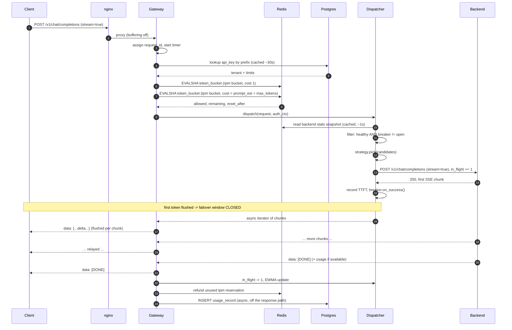
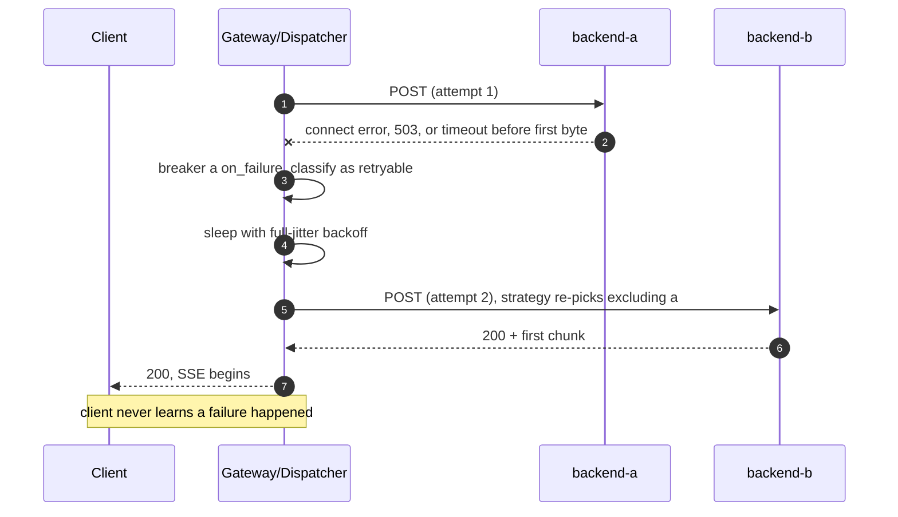
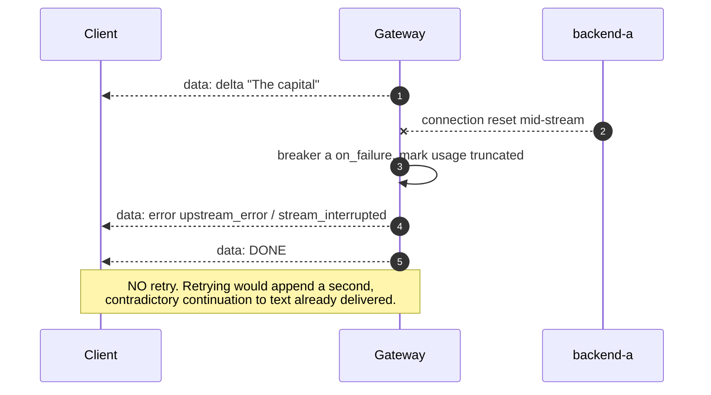

# Architecture

## 1. Tiers

StreamGate is five tiers. The split matters because each tier has a different scaling and
failure story.

| Tier | Component | State | Scales by | If it dies |
| --- | --- | --- | --- | --- |
| 1. Client | curl, OpenAI SDK, k6 | — | — | — |
| 2. Edge | nginx | none | vertical | all traffic stops (single point of failure in this demo) |
| 3. Gateway | FastAPI app, N replicas | **stateless** | horizontally, add replicas | other replicas serve; in-flight streams on the dead replica are lost |
| 4. Routing | in-process library inside each gateway | per-replica breaker + local stats cache, shared counters in Redis | with the gateway | n/a (not a separate process) |
| 5. Backend | mock-llm ×3, ollama | model weights, KV cache | add backends, register them | breaker opens, traffic shifts to healthy peers |
| 5b. State/obs | Redis, Postgres, Prometheus, Grafana | durable | vertical (demo) | see §6 degradation matrix |

### Why the routing tier is a library, not a service

A separate router process would add a network hop to every request (and to every *chunk*,
if it proxied streams) in exchange for a globally consistent view of backend load. For a
gateway whose whole job is minimising time-to-first-token, that hop is the wrong trade. So
routing runs inside the gateway process, and replicas coordinate through Redis instead of
through an extra service. [ADR-004](DESIGN_DECISIONS.md#adr-004-routing-tier-as-an-in-process-library)

## 2. Repository layout

```
StreamGate/
├── README.md                      # pitch, quickstart, tradeoffs, "what I learned"
├── LICENSE                        # MIT
├── CONTRIBUTING.md
├── Makefile                       # up, down, test, lint, typecheck, migrate, bench, chaos
├── .env.example
├── .gitignore
├── pyproject.toml                 # deps, ruff, mypy, pytest config (single source of truth)
├── docker-compose.yml             # full stack: nginx, 2 gateways, 3 mocks, redis, pg, prom, grafana
├── docker-compose.ollama.yml      # optional overlay adding a real Ollama backend
│
├── .github/workflows/ci.yml       # lint -> typecheck -> unit -> integration (compose) -> coverage
│
├── deploy/
│   ├── nginx/nginx.conf           # upstream gateways, proxy_buffering off for SSE
│   ├── prometheus/prometheus.yml  # scrape configs
│   └── grafana/
│       ├── provisioning/
│       │   ├── datasources/prometheus.yml
│       │   └── dashboards/dashboards.yml
│       └── dashboards/streamgate.json
│
├── services/
│   ├── gateway/
│   │   ├── Dockerfile
│   │   ├── alembic.ini
│   │   ├── alembic/
│   │   │   ├── env.py
│   │   │   └── versions/
│   │   └── streamgate/
│   │       ├── __init__.py
│   │       ├── main.py            # app factory + lifespan (startup/shutdown/drain)
│   │       ├── config.py          # pydantic-settings, env-driven, immutable Settings
│   │       ├── logging_setup.py   # JSON logs, request_id contextvar
│   │       ├── errors.py          # typed exceptions -> OpenAI-shaped error bodies
│   │       ├── api/
│   │       │   ├── deps.py        # auth dependency, settings dependency
│   │       │   ├── chat.py        # POST /v1/chat/completions, GET /v1/models
│   │       │   ├── admin.py       # tenants, keys, usage, backend inspection
│   │       │   └── health.py      # /healthz, /readyz, /metrics
│   │       ├── schemas/
│   │       │   ├── openai.py      # ChatCompletionRequest/Response/Chunk
│   │       │   └── admin.py
│   │       ├── auth/
│   │       │   ├── keys.py        # generate, hash (Argon2id), verify, prefix lookup
│   │       │   └── context.py     # AuthContext (tenant + limits) passed down the stack
│   │       ├── ratelimit/
│   │       │   ├── token_bucket.lua
│   │       │   ├── limiter.py     # RateLimiter: reserve(), refund(), Decision
│   │       │   └── policy.py      # how reservations are estimated
│   │       ├── routing/
│   │       │   ├── registry.py    # Backend, BackendRegistry, in-flight tracking
│   │       │   ├── health.py      # active health-check loop
│   │       │   ├── strategies.py  # RoundRobin, LeastInFlight, EwmaLatency
│   │       │   ├── breaker.py     # CircuitBreaker state machine (pure, unit-tested)
│   │       │   ├── stats.py       # Redis-backed shared in-flight/EWMA, local cache
│   │       │   └── dispatcher.py  # select -> attempt -> retry/failover orchestration
│   │       ├── proxy/
│   │       │   ├── upstream.py    # httpx client lifecycle, timeouts, limits
│   │       │   ├── sse.py         # SSE parse/serialise, disconnect-aware relay
│   │       │   └── nonstream.py   # buffered JSON path
│   │       ├── accounting/
│   │       │   ├── tokens.py      # usage extraction + estimation fallback
│   │       │   ├── pricing.py     # per-model cost table
│   │       │   └── recorder.py    # async batched writes of usage_records
│   │       ├── db/
│   │       │   ├── models.py      # SQLAlchemy 2.0 declarative models
│   │       │   ├── session.py     # async engine + sessionmaker
│   │       │   └── repo.py        # tenant/key/usage repositories
│   │       ├── observability/
│   │       │   ├── metrics.py     # Prometheus collectors (single registry)
│   │       │   └── middleware.py  # request id, access log, latency observation
│   │       └── idempotency.py     # Idempotency-Key cache (Redis)
│   │
│   └── mockllm/
│       ├── Dockerfile
│       └── mockllm/
│           ├── main.py            # OpenAI-shaped endpoints, /healthz, /admin/faults
│           ├── config.py          # base latency, tokens/sec, jitter from env
│           ├── generator.py       # deterministic token stream
│           └── faults.py          # injectable: slow, error, hang, die-mid-stream
│
├── tests/
│   ├── conftest.py
│   ├── unit/                      # breaker, strategies, limiter policy, sse parser, pricing
│   └── integration/               # against compose: streaming, 429s, failover, drain
│
├── load/
│   ├── smoke.js                   # k6: does it work at all
│   ├── steady.js                  # k6: fixed arrival rate, measure TTFT percentiles
│   └── strategy_compare.js        # k6: same load, three strategies
│
├── chaos/
│   ├── kill_backend_midstream.sh
│   ├── slow_backend.sh
│   ├── kill_gateway_replica.sh
│   └── partition_redis.sh
│
└── docs/
    ├── ARCHITECTURE.md            # this file
    ├── DESIGN_DECISIONS.md        # ADRs
    ├── DATA_MODELS.md             # schema + ER diagram + state keys
    ├── API.md
    ├── RISKS.md
    ├── TESTING.md
    ├── BENCHMARKS.md
    ├── RUNBOOK.md
    ├── INTERVIEW_PREP.md
    ├── RESUME_BULLETS.md
    └── LEARNING_RESOURCES.md
```

## 3. Request lifecycle

### 3.1 Streaming request, happy path



### 3.2 Failover before first token



### 3.3 Failure *after* first token



This is the single most important policy decision in the project, so be ready to defend it:

- HTTP status and headers are already sent, so the gateway cannot turn a `200` into a `502`.
- The deltas already flushed are part of the answer the client has rendered. A new backend
  starts from the original prompt and would produce text that does not continue what was sent.
- Making it *look* seamless would require replaying the partial completion back as prompt
  context ("continue from here"), which changes the semantics of the request, costs extra
  prefill, and is still not guaranteed to be coherent. That is a real technique (resumable
  streams) but it is an explicit product decision, not a transparent retry.
- So: fail loudly, in-band, with a terminal error event, and let the client decide.

### 3.4 Client disconnect

When the client goes away mid-stream, Starlette's response generator is cancelled. StreamGate
catches that cancellation and **closes the upstream httpx response**, which sends the backend a
connection close so it can stop generating. Without this, a client pressing Ctrl-C leaves a
backend burning GPU time on tokens nobody will read — the leak that quietly destroys capacity
under load. The accounting path still runs in a `finally` block, recording the request as
`client_disconnected` with whatever tokens were delivered.

## 4. Data flow and where state lives

| State | Store | Access pattern | Why there |
| --- | --- | --- | --- |
| Tenants, API key hashes, limits | Postgres | read-heavy, cached in-process ~30 s | durable, relational, rarely changes |
| Usage records | Postgres | append-only writes, batched | needs durability + SQL aggregation for billing |
| Token buckets (rpm/tpm) | Redis | read-modify-write per request, atomic via Lua | needs to be shared and fast; losing it is survivable |
| Backend in-flight counts | Redis hash + local delta | incr/decr per request, snapshot read ~1 s | replicas must see each other's load |
| Backend EWMA latency | Redis hash + local | write on completion, snapshot read | same |
| Breaker state | per-replica, in-memory | hot path, every request | intentionally local; see [ADR-007](DESIGN_DECISIONS.md#adr-007-per-replica-circuit-breakers) |
| Idempotency responses | Redis, TTL 24 h | write once, read on retry | ephemeral by nature |
| Metrics | in-process registry, scraped | Prometheus pull | standard |

## 5. Backpressure

Three queues can build up, and each needs an answer:

1. **Backend → gateway.** `httpx`'s `aiter_bytes()` only reads from the socket when the
   consumer asks for the next chunk, so TCP flow control does the work: a slow consumer stops
   reading, the receive window closes, and the backend's writes block. There is no unbounded
   buffer in the middle, which is precisely why StreamGate never accumulates chunks in a list.
2. **Gateway → client.** Starlette awaits each `yield` until the ASGI server has handed the
   bytes to the socket, so a slow client slows the generator, which slows the upstream read.
   Chain complete.
3. **nginx.** `proxy_buffering off` (and `X-Accel-Buffering: no` on the response) is mandatory —
   otherwise nginx buffers the SSE body and destroys TTFT, making the whole streaming feature
   invisible.

Admission control (bounded concurrency per tenant) is explicitly *future work*: today the
limit is the rate limiter plus httpx connection-pool limits per backend.

## 6. Failure modes and degradation matrix

| Failure | Detection | Behaviour | Degradation |
| --- | --- | --- | --- |
| One backend returns 5xx | breaker counts failures | breaker opens after threshold, backend removed from candidates, probed after cooldown | capacity drops, no errors to clients while peers absorb load |
| One backend slow (not failing) | EWMA latency rises, in-flight climbs | latency-aware strategy starves it naturally; health check timeout may open breaker | higher p99 |
| Backend dies mid-stream | read error on the response body | terminal SSE error event, usage marked truncated, no retry | that one request fails |
| All backends unhealthy | no candidates | `503 no_backend_available`, `Retry-After` | hard outage, fast and honest |
| Redis down | command error / timeout | **fail-open** for rate limiting (serve, log, increment `ratelimit_degraded_total`), routing falls back to local-only stats | limits unenforced; availability preserved. [ADR-006](DESIGN_DECISIONS.md#adr-006-fail-open-when-redis-is-unavailable) |
| Postgres down | connection error | auth falls back to the in-process key cache; usage records buffered in memory, dropped past a cap with a counter | new/rotated keys rejected, some billing data lost |
| Gateway replica killed | nginx health check / connection refused | new requests go to peers; streams on that replica die | in-flight requests on that replica fail |
| Graceful shutdown (SIGTERM) | lifespan handler | stop accepting new requests, keep draining open streams up to `DRAIN_TIMEOUT`, then cancel | zero-downtime deploys |
| Client disconnects | generator cancellation | upstream response closed, in-flight decremented, usage recorded | none — this is the correct path |

## 7. Concurrency model

One event loop per uvicorn worker; everything on the request path is `async`. Rules the code
holds to:

- **No blocking calls on the loop.** Argon2 verification is CPU-bound in the tens of
  milliseconds, so it runs in a thread pool (`anyio.to_thread`), and is short-circuited by the
  key cache for repeat requests.
- **One shared `httpx.AsyncClient`** for the process, created in lifespan, with per-backend
  connection-pool limits and keep-alive. Creating a client per request would mean a fresh TCP
  (and TLS) handshake per request, which shows up directly in TTFT.
- **No global mutable singletons.** Registry, limiter, breakers and clients hang off
  `app.state`, are constructed in the app factory, and are injected into handlers. This is what
  makes the components unit-testable without a running server.
