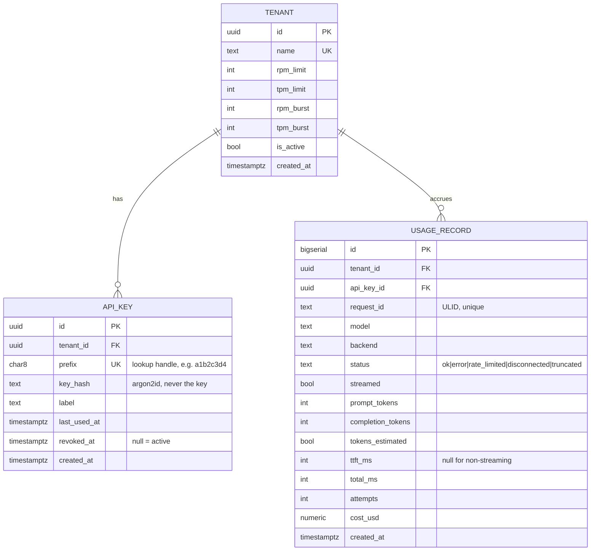

# Data models

## 1. Postgres (durable)



### Table notes, and why each column is there

**`tenant`** — limits live on the tenant, not in config, so they can change without a deploy.
`rpm_burst` / `tpm_burst` are the token-bucket capacities; `rpm_limit` / `tpm_limit` are the
refill rates per minute. Separating rate from burst is the whole point of a token bucket: you
can allow a short spike of 20 requests while still averaging 60/min.

**`api_key`** — the plaintext key is shown exactly once, at creation, and never stored. Format:

```
sg_<8-char prefix><32-char secret>     e.g. sg_a1b2c3d4K7f2...
      └── indexed, non-secret  └── hashed with Argon2id
```

The prefix exists to make lookup an indexed single-row fetch. Without it you would have to
Argon2-verify the candidate key against *every* row in the table, because a password hash is
not searchable. This is the standard design (GitHub, Stripe and friends do the same thing) and
it is a very common interview question.

**`usage_record`** — one row per request attempt-chain, written off the response path.
`request_id` is unique, which makes the writer naturally idempotent on retry.
`tokens_estimated` is a deliberate honesty flag: when a backend does not report usage for a
stream, the number is a tokenizer estimate and downstream billing should know that.
`attempts` records how many backends were tried, which is how you later prove failover worked.

Indexes: `api_key(prefix)` unique; `usage_record(tenant_id, created_at desc)` for the usage
endpoint; `usage_record(request_id)` unique; `usage_record(created_at)` for retention cleanup.

**Not stored in Postgres:** prompts and completions. The gateway never persists message
content — it is multi-tenant, so storing user text would turn a routing component into a data
custodian. Only metadata and counts.

## 2. Redis keyspace (ephemeral, shared)

| Key | Type | Written by | TTL | Purpose |
| --- | --- | --- | --- | --- |
| `sg:rl:{tenant_id}:req` | hash `{tokens, ts}` | rate-limit Lua script | 2× window | requests/min bucket |
| `sg:rl:{tenant_id}:tok` | hash `{tokens, ts}` | rate-limit Lua script | 2× window | tokens/min bucket |
| `sg:be:inflight` | hash `backend -> int` | dispatcher (HINCRBY) | none | cluster-wide concurrency per backend |
| `sg:be:ewma` | hash `backend -> float ms` | dispatcher on completion | none | smoothed latency per backend |
| `sg:be:health` | hash `backend -> json` | health-check loop | none | last probe result (observability; routing uses local state) |
| `sg:idem:{tenant_id}:{key}` | string (json) or sentinel | chat handler | 24 h | idempotent replay of non-streaming responses |

Design notes:

- Buckets are **lazy**: nothing refills them on a timer. The script stores `(tokens, ts)` and
  computes the refill from elapsed time on each access. No background job, no clock skew
  between replicas mattering, because the authoritative clock is Redis's own `TIME`.
- Hashes are used for backend stats so a single `HGETALL` gives the dispatcher a full snapshot
  in one round trip, which it then caches for ~1 s.
- In-flight counters can drift upward if a gateway is SIGKILLed mid-request. Mitigation: each
  replica also tracks its own contribution and subtracts it on shutdown, plus a periodic
  reconciliation task resets counters that exceed a sanity bound. Documented as a known risk
  ([RISKS.md](RISKS.md) R-05) rather than pretended away.

## 3. In-process models (no persistence)

```python
# routing/registry.py
@dataclass(frozen=True)
class BackendConfig:
    name: str
    base_url: str
    models: tuple[str, ...]      # which model ids this backend can serve
    weight: float = 1.0
    max_concurrency: int = 32

@dataclass
class BackendRuntime:
    config: BackendConfig
    healthy: bool = True
    local_in_flight: int = 0
    ewma_latency_ms: float = 0.0
    queue_depth: int = 0          # reported by backend health payload, if it offers one
    breaker: CircuitBreaker = ...
    consecutive_health_failures: int = 0
```

```python
# auth/context.py
@dataclass(frozen=True)
class AuthContext:
    tenant_id: UUID
    tenant_name: str
    api_key_id: UUID
    rpm_limit: int; rpm_burst: int
    tpm_limit: int; tpm_burst: int
```

```python
# accounting/recorder.py
@dataclass
class RequestOutcome:
    request_id: str
    model: str
    backend: str | None
    status: Literal["ok","error","rate_limited","disconnected","truncated"]
    streamed: bool
    prompt_tokens: int
    completion_tokens: int
    tokens_estimated: bool
    ttft_ms: int | None
    total_ms: int
    attempts: int
```

`BackendConfig` is frozen; `BackendRuntime` is the mutable half. Keeping configuration and
runtime state in separate types means config can be reloaded or compared without touching live
counters, and it makes the strategies trivially unit-testable: you construct a list of
`BackendRuntime` objects with chosen numbers and assert which one gets picked. No Redis, no
HTTP, no event loop needed.

## 4. Backend registration

Backends come from environment configuration, parsed at startup (JSON in an env var, so compose
can define it without a config file mount):

```
STREAMGATE_BACKENDS='[
  {"name":"mock-a","base_url":"http://mock-llm-a:9000","models":["mock-small"]},
  {"name":"mock-b","base_url":"http://mock-llm-b:9000","models":["mock-small"]},
  {"name":"mock-c","base_url":"http://mock-llm-c:9000","models":["mock-small","mock-large"]},
  {"name":"ollama","base_url":"http://ollama:11434","models":["llama3.2"]}
]'
```

Static registration is the right call here: dynamic service discovery (Consul, etcd, Kubernetes
endpoints) is a different project, and the health-check loop already handles the only thing that
actually changes at runtime — whether a known backend is usable.
